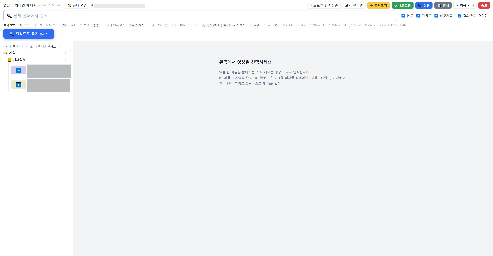
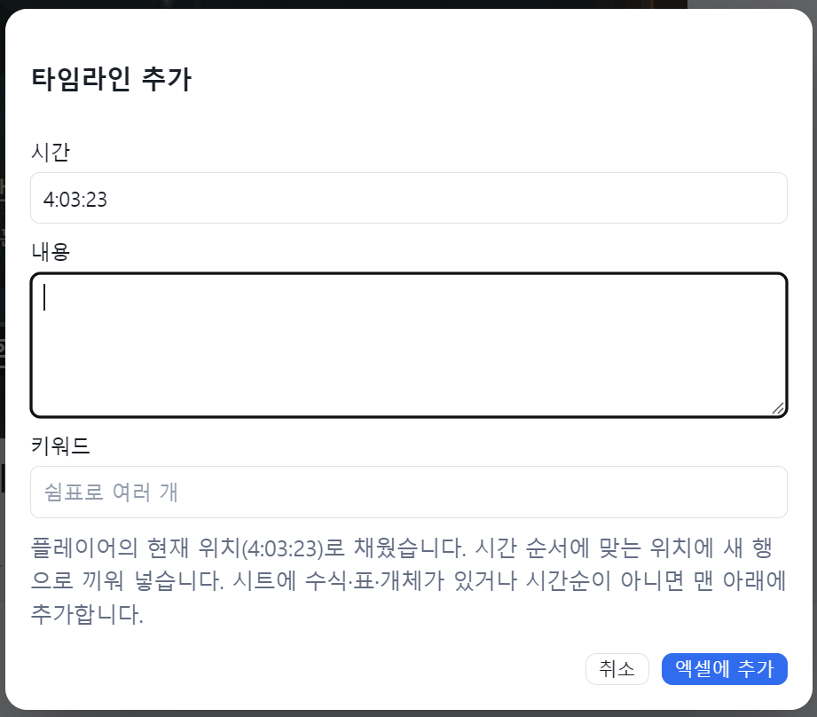
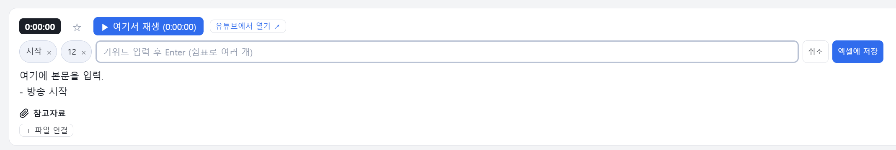
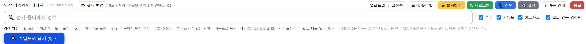
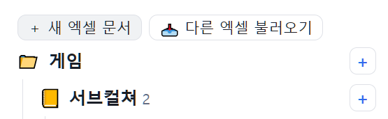
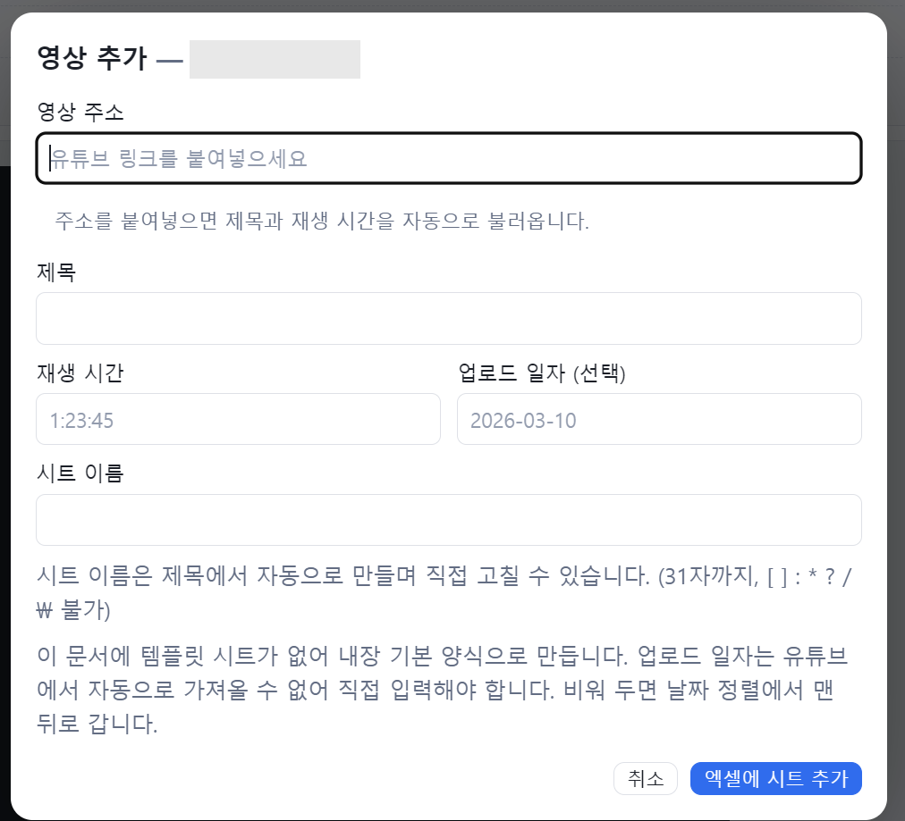
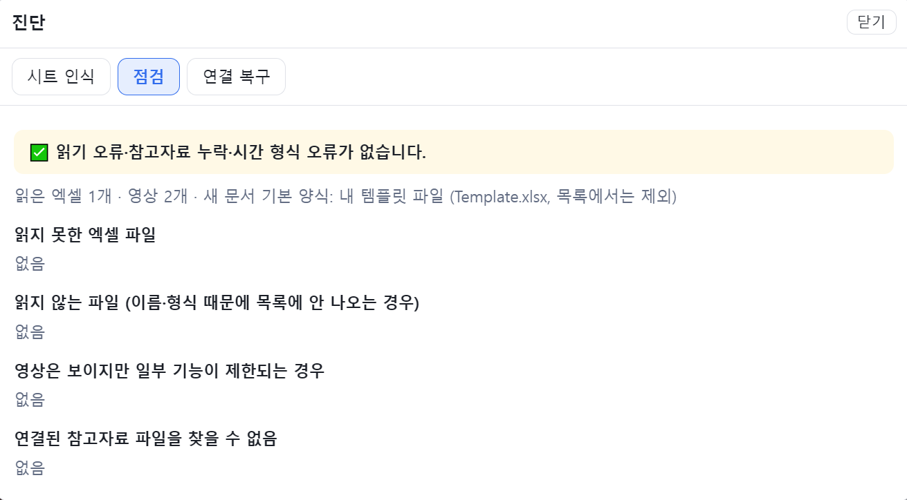
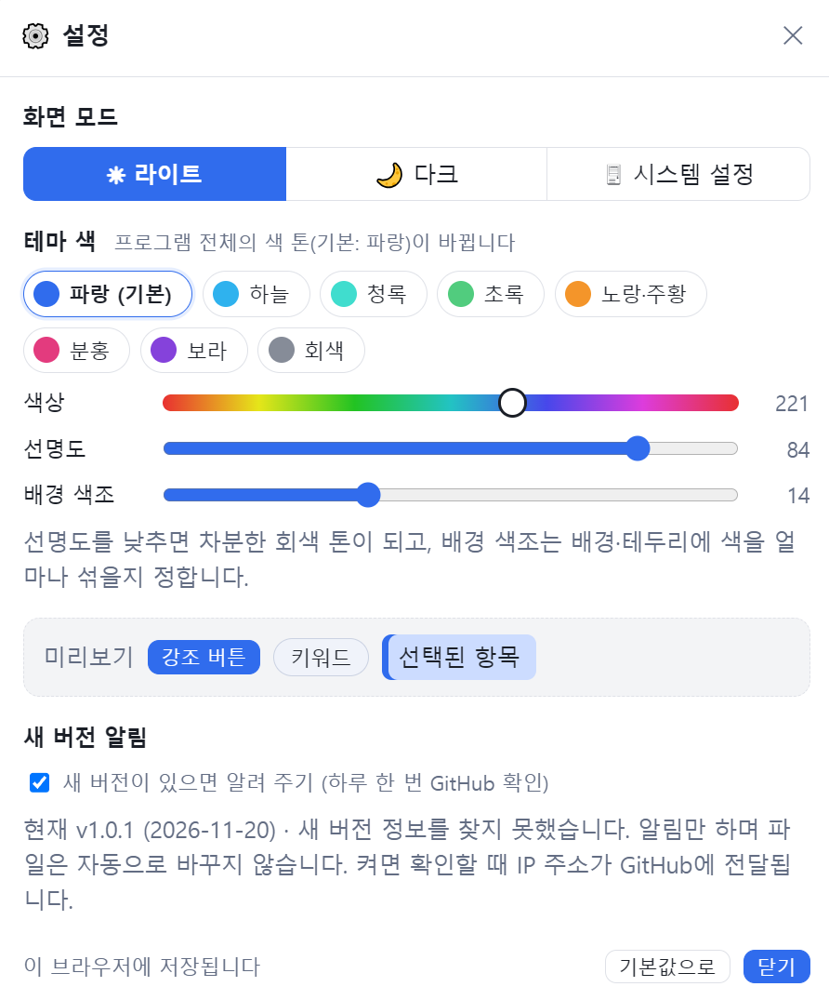
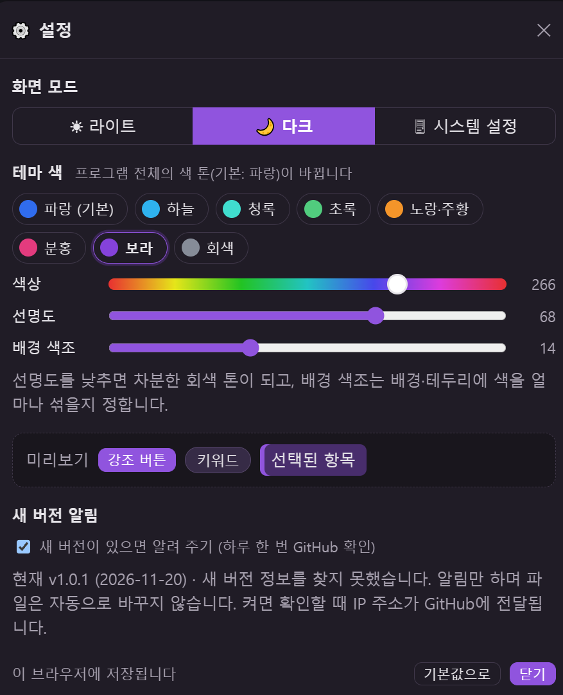

# 사용법 (Video Timeline Manager)

[← README로 돌아가기](../README.md)

> 이 문서의 화면 이미지는 예시 데이터로 만들었습니다. 영상 플레이어 자리는 설명용 대체 화면이며, 실제로는 YouTube 영상이 재생됩니다.

## 목차
1. [시작하기](#1-시작하기)
2. [엑셀 양식](#2-엑셀-양식)
3. [화면 구성](#3-화면-구성)
4. [타임라인 막대와 재생](#4-타임라인-막대와-재생)
5. [타임라인 추가·수정](#5-타임라인-추가수정)
6. [키워드](#6-키워드)
7. [검색](#7-검색)
8. [즐겨찾기](#8-즐겨찾기)
9. [참고자료 연결](#9-참고자료-연결)
10. [새 엑셀 문서·영상(시트) 추가](#10-새-엑셀-문서영상시트-추가)
11. [다른 엑셀 불러오기(병합)](#11-다른-엑셀-불러오기병합)
12. [진단과 연결 복구](#12-진단과-연결-복구)
13. [설정(모드·색)](#13-설정모드색)
14. [종료·백업·정리](#14-종료백업정리)
15. [새 버전 알림](#15-새-버전-알림)
16. [문제가 생겼을 때](#16-문제가-생겼을-때)

---

## 1. 시작하기
1. **Python 3.8 이상**을 설치합니다(추가 패키지는 필요 없습니다).
2. `run.bat`을 더블클릭하면 검은 창이 뜨고 브라우저에서 프로그램이 열립니다(`http://127.0.0.1:8765/`). macOS/Linux는 터미널에서 `python3 app.py`를 실행합니다.
3. 엑셀 파일이 들어 있는 폴더를 쓰려면 화면 위의 **📂 폴더 변경**을 누르세요. 바꾸지 않으면 프로그램 폴더 안의 `library/`를 씁니다.
4. 끝낼 때는 오른쪽 위 **종료**를 누릅니다(브라우저만 닫으면 약 3분 뒤 자동 종료).

화면 왼쪽 위의 `v1.0.0`은 실행 중인 버전입니다. 붉게 표시되면 프로그램 파일을 바꾼 뒤 서버를 다시 실행하지 않았다는 뜻입니다.

## 2. 엑셀 양식
**엑셀 파일 하나 = 폴더처럼 묶음, 시트 하나 = 영상 하나**입니다. 시트는 아래 위치를 지켜 주세요.

| 위치 | 내용 |
|---|---|
| B1 | 영상 제목 |
| B2 | 영상 주소(유튜브 링크) |
| B3 | 업로드 일자 (예: 2026-03-10) |
| C3 / D3 | `재생 시간` / 영상 길이 (예: 0:25:00) |
| 4행 | 머리글: `타임라인` · `내용` · `키워드` |
| 5행부터 | 시간 · 내용 · 키워드(오른쪽 칸으로 계속) |

- 시간은 `1:23:45`, `12:30`처럼 적습니다.
- 키워드는 한 칸에 하나씩 오른쪽으로 적습니다.
- 라이브러리 **맨 위 폴더**에 `Template.xlsx`를 두면 새 문서를 만들 때 이 파일을 복사해 시작합니다. 이 파일 자체는 목록에 나오지 않습니다.
- 이름이 `템플릿` 또는 `Template`인 시트는 목록에서 항상 제외됩니다. 영상 시트를 추가할 때 이 시트를 복사해 만듭니다.

## 3. 화면 구성

- **왼쪽:** 폴더 › 엑셀 문서 › 영상 목록. 폴더/문서/영상 앞의 아이콘을 눌러 이모지로 바꿀 수 있습니다. `＋`는 해당 폴더에 새 문서, 해당 문서에 새 영상을 추가합니다.
- **가운데:** 영상 플레이어, 제목·업로드일·파일 위치, 타임라인 막대, 선택한 타임라인의 상세, 타임라인 목록.
- **위쪽:** 전체 검색, 키워드로 찾기, 정렬·보기 방식, 즐겨찾기, 새로고침, 진단, 설정, 이용 안내, 종료.
- 엑셀 파일을 저장하면 화면이 자동으로 반영됩니다. 바로 다시 읽고 싶으면 **새로고침**을 누릅니다.

## 4. 타임라인 막대와 재생
- 막대의 각 칸이 타임라인 하나입니다. 칸을 누르면 그 지점의 내용이 아래에 나타나고 목록에서도 강조됩니다.
- **★**가 막대 위에 있으면 그 지점에 즐겨찾기가 있다는 뜻입니다(눌러서 이동할 수 있습니다).
- 막대 위에서 **마우스 휠**로 확대·축소, 확대한 뒤에는 **끌어서** 이동합니다. `확대·축소` 줄의 버튼으로도 조절할 수 있습니다.
- 상세 영역의 **▶ 여기서 재생**은 그 시간부터 재생하고, **유튜브에서 열기**는 유튜브 사이트에서 그 시간으로 엽니다(임베드가 막힌 영상은 이쪽을 쓰세요).
- **재생 시간**은 엑셀의 `재생 시간` 칸에서 읽습니다. 비어 있으면 마지막 타임라인 기준으로 계산하며, 직접 입력할 수도 있습니다.
- 타임라인 목록은 목록 안에서 스크롤됩니다. 막대나 ★로 이동하면 해당 줄이 맨 위쪽에 오도록 부드럽게 움직입니다.

## 5. 타임라인 추가·수정

- **＋ 타임라인 추가**: 시간, 내용, 키워드를 입력하면 엑셀의 **시간 순서에 맞는 위치**에 새 행으로 끼워 넣습니다. 시트에 표·수식이 있거나 시간순이 아니면 맨 아래에 추가하고 알려 줍니다.
- 시간 칸에 **유튜브 타임스탬프 링크**를 붙여 넣으면 시간으로 바꿔 줍니다.
- 영상을 재생하거나 멈춘 적이 있으면 **플레이어의 현재 위치**가 시간 기본값으로 들어갑니다.
- 내용 수정은 상세 영역의 **✎ 내용 수정**에서 합니다. 저장하면 엑셀 셀에 바로 반영됩니다.
- 엑셀이 열려 있어 저장할 수 없다는 안내가 나오면 엑셀에서 저장하고 닫은 뒤 다시 시도하세요.

## 6. 키워드
- 타임라인 아래 키워드 칩의 **＋ 키워드 편집**에서 추가·삭제합니다(쉼표로 여러 개, Enter로 추가, 칩의 ×로 삭제).
- 입력하면 **이미 있는 키워드**가 아래에 추천됩니다. 초성으로도 찾을 수 있고, ↑↓로 고르고 Enter로 선택합니다. 입력칸을 눌렀을 때나 ↓ 키를 눌렀을 때도 목록이 열립니다.
- 키워드 칩을 누르면 해당 키워드가 쓰인 곳의 미리보기가 열리고, 키워드별 **색상**을 지정할 수 있습니다.

- 위쪽 **🔍 키워드로 찾기**를 누르면 전체 키워드 목록이 나옵니다. 이름순·개수순 정렬, 초성/알파벳 바로가기, 거르기를 지원합니다. 숫자는 그 키워드가 적힌 타임라인 수입니다.

## 7. 검색

- 맨 위 검색창은 **전체 폴더**를 대상으로 합니다. 본문 · 키워드 · 참고자료 이름 중 어디서 찾을지 체크로 고르고, `결과 있는 영상만`으로 목록을 줄일 수 있습니다.
- 결과가 있는 영상에는 일치한 타임라인 수가 표시되고, 막대에서도 일치한 구간이 강조됩니다. ▲▼로 일치 항목 사이를 이동합니다.
- 영상 안에서만 찾으려면 막대 옆의 **이 영상 안에서 검색**을 씁니다.

| 쓰는 법 | 뜻 |
|---|---|
| `가 나` 또는 `가 & 나` | 둘 다 포함 |
| `가 OR 나` | 하나라도 포함 (OR은 대문자) |
| `(가 OR 나) & 다` | 괄호로 묶어 먼저 계산 |
| `'두 단어'` | 띄어쓰기가 있는 단어는 따옴표로 묶기 |

조건은 **한 타임라인 안에서** 판단합니다. 검색창 아래 `해석:`에 프로그램이 이해한 검색식이 표시됩니다.

## 8. 즐겨찾기
- 타임라인 목록의 **☆**를 누르면 즐겨찾기로 추가됩니다(★로 바뀝니다).
- 위쪽 **★ 즐겨찾기**에서 폴더 계층으로 정리·이동·이름 변경·삭제·검색을 합니다.
- 검색하면 일치하는 즐겨찾기가 결과 위쪽에 별도 구역으로 나옵니다.
- 즐겨찾기는 엑셀이 아니라 `timeline-refs.json`에 저장됩니다.

## 9. 참고자료 연결
- 상세 영역의 **＋ 파일 연결**로 이 타임라인과 관련된 파일(문서, 이미지 등)을 연결합니다.
- 연결한 파일은 이름을 눌러 미리 보거나 기본 프로그램으로 열고, 폴더에서 위치를 볼 수 있습니다.
- 연결 정보도 `timeline-refs.json`에 저장되며 원본 파일을 복사하거나 옮기지 않습니다.

## 10. 새 엑셀 문서·영상(시트) 추가

- **＋ 새 엑셀 문서**(또는 폴더의 `＋`): 폴더와 파일 이름을 입력하면 만들어집니다. 없는 폴더는 새로 만들고, 라이브러리 맨 위의 `Template.xlsx`가 있으면 그것을 복사합니다.

- **영상(시트) 추가**(문서의 `＋`): 영상 주소를 붙여 넣으면 **제목과 재생 시간을 자동으로** 불러옵니다(인터넷 연결 필요). 업로드 일자는 직접 입력합니다. 시트 이름은 제목에서 자동으로 만들며 고칠 수 있습니다.
- 그 문서 안의 `템플릿`/`Template` 시트가 있으면 복사해서 만들고, 없으면 내장 기본 양식으로 만듭니다.

## 11. 다른 엑셀 불러오기(병합)

다른 사람(또는 다른 PC)에서 만든 엑셀의 타임라인을 **내 영상에 골라서 합치는** 기능입니다.

1. 왼쪽 위 **📥 다른 엑셀 불러오기**를 누르고 엑셀 파일을 고릅니다.
2. 파일 안 영상 시트의 주소를 내 영상과 비교해 **같은 영상**을 찾습니다. 같은 영상이 없으면 `＋ 새 시트로 추가`로 새 시트를 만들 수 있습니다.
3. 타임라인마다 체크해서 가져올 것만 고릅니다.

| 표시 | 기본 | 뜻 |
|---|---|---|
| 새 항목 | 체크 | 내 영상에 없는 시간의 항목 |
| 같은 시간·내용 다름 | 체크 | 기존 항목 **뒤에 별도 행**으로 추가(덮어쓰지 않음) |
| 이미 있음 | 해제 | 같은 시간·같은 내용 |
| 비슷한 시간(±3초)·같은 내용 | 해제 | 편집본 차이일 가능성 |

- 가져오는 것은 **시간 · 내용 · 키워드**뿐입니다(참고자료·즐겨찾기·키워드 색은 제외). `키워드는 가져오지 않기`로 키워드를 뺄 수도 있습니다.
- 불러올 파일은 **읽기만** 하며 수정하지 않습니다. 합치기 전에 내 대상 파일을 `.backup` 폴더에 백업합니다.
- 불러올 파일도 [2장](#2-엑셀-양식)의 양식이어야 읽힙니다. 읽을 수 없으면 이유를 알려 줍니다.

## 12. 진단과 연결 복구

- **🩺 진단**에는 `시트 인식` · `점검` · `연결 복구` 탭이 있습니다. 오류가 있으면 버튼이 **빨갛게** 강조되고 개수가 표시됩니다.
- **시트 인식**: 각 시트를 어떻게 읽었는지(타임스탬프·키워드 수, 재생 시간)와 제외된 시트의 이유를 보여 줍니다.
- **점검**: 읽지 못한 파일, 참고자료 누락, 시간 형식 오류 등을 모아 보여 줍니다.
- **연결 복구**: 엑셀 파일의 위치나 이름을 바꿨을 때, 즐겨찾기·참고자료·아이콘 연결을 새 위치로 옮깁니다. **종료하기 전에** 해 두세요(종료 시 정리가 일어납니다).

## 13. 설정(모드·색)

- **화면 모드**: 라이트 / 다크 / 시스템 설정.
- **테마 색**: 프리셋, 또는 색상 · 선명도 · 배경 색조 슬라이더. 프로그램 전체의 색 톤이 바뀝니다. 설정은 이 브라우저에 저장됩니다.
- **새 버전 알림**: 켜고 끌 수 있습니다([15장](#15-새-버전-알림)).

## 14. 종료·백업·정리
- 엑셀을 고칠 때마다 `library/.backup`에 사본을 만듭니다(파일당 최근 10개).
- **종료할 때** 엑셀에 더 이상 없는 항목의 흔적(없어진 영상·타임라인에 연결된 참고자료 등)을 `timeline-refs.json`에서 정리합니다. 정리된 내용은 `timeline-refs.removed.json`에 보관됩니다(최근 30건). 되돌리는 화면은 없으니 필요하면 이 파일에서 직접 복원하세요.
- 안전장치: 읽은 파일이 없거나 읽기 오류가 있거나, 참고하던 엑셀의 절반 이상이 사라진 경우(드라이브 연결 문제 등)에는 정리하지 않습니다.
- 중요한 엑셀은 별도로도 백업하세요.

## 15. 새 버전 알림
- 켜져 있으면 하루 한 번 GitHub의 최신 릴리스 번호만 확인하고, 새 버전이면 화면 위에 알림을 띄웁니다. **알림만** 하며 파일을 자동으로 바꾸지 않습니다.
- 확인할 때 사용자의 IP가 GitHub에 전달됩니다. 원하지 않으면 **설정 → 새 버전 알림**에서 끄세요.
- 새 버전은 저장소의 [Releases](https://github.com/ERIM-Hyun/Video-Timeline-Manager/releases)에서 받아, `config.json`과 `library/`는 그대로 두고 프로그램 파일(`app.py`, `web/` 등)만 덮어쓴 뒤 서버를 다시 실행합니다.

## 16. 문제가 생겼을 때
| 증상 | 확인할 것 |
|---|---|
| 영상이 재생되지 않음 | 올린 사람이 임베드를 막았을 수 있습니다. **유튜브에서 열기**를 사용하세요. 인터넷 연결도 확인하세요. |
| 시트가 목록에 안 보임 | **진단 → 시트 인식**에서 이유를 확인하세요. B1(제목)·B2(주소)가 비어 있거나 `템플릿`/`Template` 이름이면 제외됩니다. |
| 저장이 안 됨 | 엑셀에서 그 파일이 열려 있으면 저장하고 닫은 뒤 다시 시도하세요. 구글 드라이브 동기화 중에도 잠길 수 있습니다. |
| 타임라인이 맨 아래에 추가됨 | 시트가 시간순이 아니거나 표·수식이 있으면 안전을 위해 맨 아래에 추가합니다. |
| 화면 위에 "이전 버전으로 실행 중" | `종료` 후 `run.bat`을 다시 실행하세요. |
| 제목 자동 입력이 안 됨 | 인터넷 연결이나 YouTube 응답 문제일 수 있습니다. 제목을 직접 입력하세요. |
| 연결이 끊어짐 | 검은 창이 닫혔을 수 있습니다. `run.bat`을 다시 실행한 뒤 새로고침하세요. |

더 자세한 구조는 [코드 설명서](코드_설명서.md)를 참고하세요. 문제는 [Issues](https://github.com/ERIM-Hyun/Video-Timeline-Manager/issues)에 남겨 주세요.
